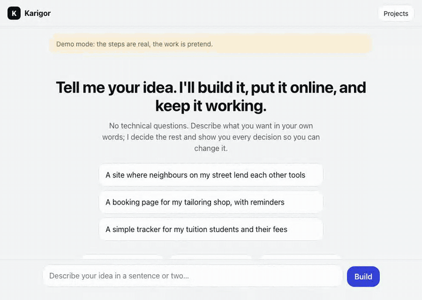

# Karigor

**Karigor** (Bangla: *craftsperson*) is free, open-source software in which a team of AI agents takes an idea from a person with no technical knowledge all the way to deployed, maintained software. After the idea and a one-time budget choice, no human is involved. Nobody is ever asked a technical question.

<p align="center">
  
  <br>
  <sub>A run in the chat UI on the free <code>demo</code> adapter (no model, no cost: the steps are real, the work is pretend). Website: <a href="https://karigor-ten.vercel.app">karigor-ten.vercel.app</a></sub>
</p>

Plenty of tools generate code from a prompt. Karigor is different in two ways:

1. **It owns the whole lifecycle.** Specify, design, plan, build, verify, release, and then watch production and fix what breaks. Not "here is a repo, good luck."
2. **Reliability comes from process, not trust.** A small, deterministic kernel runs a real software process (sprints, phase gates, a skeptic who can only object) and no step moves forward without mechanical evidence: tests green, security scan clean, a healthy preview, a verified rollback. Agents will make mistakes; the gates stop them reaching you.

It is designed to cost nothing to try. Every step has a zero-dollar path (local models, free hosting tiers), cost is a gate rather than a surprise, and the system asks you to pick a budget tier exactly once.

## Status

All six sub-projects of the first roadmap are in: the kernel, intake, the build crew, deploy and operate, the maintenance loop, and the chat UI with a Docker self-host.

On 20 October 2026 a real run on a Claude Code login took "a page where my family keeps one shared shopping list" from idea to Vercel: the `linear` process, 12 backlog items built and reviewed, one lint failure caught and fixed, a preview checked behind Vercel's login, then promoted to a public `*.vercel.app` address. It cost nothing extra on the subscription (about USD 6.48 at API prices). The same run exposed real gaps, now fixed: Vercel needed the project created first and a framework declared; a protected preview's redirect to the login page must not count as healthy; and promotion must wait until the public address serves the new build, not the one before it. It also produced an app that went live but could not work: it needed a family passcode, a signing secret and a hosted database that nobody had set. Karigor now makes secrets like the signing key itself, asks the person in plain words for what only they can choose (the passcode) or provide (a free database account), stores the values only where the app runs, and rebuilds the live version with them.

The Docker image builds and serves the UI; it refuses to listen beyond localhost without a token.

On 22 October 2026 Karigor learned to build systems, not just small apps: the product owner plans the whole product and splits it into stages, `karigor grow` builds each next stage on top of what is live, the architecture names the system's roles and modules and is revised every stage, every web app starts with tested sign-in for many people with roles and permissions, and a release needs browser journeys (each kind of user's main jobs, at phone and desktop size) to pass on a brand-new database. See [the design](docs/superpowers/specs/2026-10-22-karigor-growing-systems-design.md).

The packages:

| Package | What it does |
|---|---|
| `@karigor/store` | Typed artifacts (spec, backlog, test reports, gate results, deploy records, work items, cost ledger...) and an append-only event log that is the single source of truth. Crash anywhere; `resume` replays to the exact state. |
| `@karigor/process` | Declarative process templates (`iterative`, `linear`, `spike-then-build`, `maintenance`, `stage`) and a pure state machine with failure ladders: retry, send back, shrink, park, stop. |
| `@karigor/gates` | Mechanical gates (tests, lint, build, security scan, browser journeys, preview health, rollback) and judged gates (reviewer and skeptic with rubrics). A judged verdict with no citations is a fail. |
| `@karigor/runtime` | Role prompts and output schemas, a worker runner (schema rejection, retry with the error quoted, tier escalation), and two kinds of adapter. Model adapters: Claude Code headless (no key), the Anthropic API, Ollama (local, free) and a mock. Agent adapters act inside a workspace: Claude Code with tools, `ModelAgent` (any model writing whole files), and a scripted mock. |
| `@karigor/profiles` | Target profiles: what kind of software gets built and how it is served. `web-app` is Next.js + TypeScript + Tailwind + Drizzle (SQLite locally, libsql/Turso-ready) + Vitest + Playwright, scaffolded with sign-in for many people with roles, an activity log, the Ledger UI kit (sidebar, data tables, charts, dialogs) and browser journeys, so tests, lint, build and journeys pass before the first item. |
| `@karigor/sandbox` | The project's real workspace: a git repository where every backlog item lands as a commit, and a sandbox that runs the profile's real tests, lint, build, dependency audit and secrets scan. Dropped or parked work is reverted so it never ships. |
| `@karigor/deploy` | Where releases go. `local` (this computer, no account): each release is built into its own directory, previewed on a spare port, health-checked, then promoted; rollback is a pointer move, and verifying it starts the live release on a spare port. `vercel` (free hobby tier, `VERCEL_TOKEN`): deploy, promote and rollback through the Vercel CLI. |
| `@karigor/budget` | Prices, a three-tier estimate (free, cheap, best), a running meter, and the overspend ladder: downgrade the model, then park optional work, then stop. Fix rounds get their own budget slice. |
| `@karigor/cli` | `karigor new`, `run`, `resume`, `status`, `cost`, `explain`, `park`, `unpark`, plus `feedback`, `correct`, `fix`, `watch` and `serve` for life after release. Plain language throughout. |
| `@karigor/server` | The chat UI: a phone-first page where an idea is the first message, progress arrives as plain sentences, every decision can be corrected, and messages after release become fixes. No framework, no build step. |

**New here?** [Building an app with Karigor](docs/guide.md) walks through it step by step: describing your idea, the build, settings, using the app, asking for changes, and putting it online.

## Try it in two minutes, free

```sh
git clone https://github.com/kishormorol/karigor
cd karigor
npm install -g pnpm   # if you do not have it
pnpm install && pnpm build
node packages/cli/dist/bin.js new "A site where neighbours lend each other tools" --adapter demo --run
```

The `demo` adapter is a scripted mock: no model, no cost, the whole process runs end to end so you can watch the kernel work. Then:

```sh
node packages/cli/dist/bin.js status <projectId>
node packages/cli/dist/bin.js explain <projectId>
node packages/cli/dist/bin.js feedback <projectId> "Please show who has my drill"
node packages/cli/dist/bin.js fix <projectId> --adapter demo
```

Or the chat UI, on the same demo: `pnpm ui --adapter demo`, then open http://127.0.0.1:4321.

## Build for real

You do **not** need an API key. With [Claude Code](https://claude.com/claude-code) installed and signed in, drop `--adapter demo`: Claude Code runs headless under your own login, both for the thinking roles and as the developer inside the project's workspace (edits confined to the workspace; network, privilege and publishing commands denied). On a subscription the calls cost nothing extra; the meter still shows the pay-per-token equivalent.

```sh
node packages/cli/dist/bin.js new "..." --run                       # Claude Code login, no key
node packages/cli/dist/bin.js new "..." --adapter ollama --run      # a local model through Ollama, free and offline
node packages/cli/dist/bin.js new "..." --adapter claude --run      # Anthropic API key in ANTHROPIC_API_KEY
```

With Ollama, set `KARIGOR_OLLAMA_MODEL` (default `qwen2.5:7b`; small models are fast but weaker, and the gates will park more of their work). Any adapter other than Claude Code builds through `ModelAgent`, which writes whole files and leaves running the tests to the gates.

### Where it goes live

By default releases go to **this computer** (`--deploy local`). A finished project is previewed, checked, and promoted; run it with

```sh
node packages/cli/dist/bin.js serve <projectId>       # http://localhost:3000
```

`serve` also watches it: errors in the app's output, a failing health check, or a vulnerable library become work items, a fix round runs, and the new release replaces the old one without you doing anything.

For a public link, use Vercel's free tier: create a token at vercel.com/account/tokens, then

```sh
VERCEL_TOKEN=... node packages/cli/dist/bin.js new "..." --deploy vercel --run
node packages/cli/dist/bin.js watch <projectId> --every 15     # health and audit, fix rounds when needed
```

The web-app stores data in SQLite on your computer. On Vercel, give it a free [Turso](https://turso.tech) database by setting `DATABASE_URL` and `DATABASE_AUTH_TOKEN` before deploying; they are passed through by name and never written into the project. Secrets the app needs (a signing key) are made and stored automatically before the preview. Anything only you can choose or provide (a passcode, a database account) is listed by `karigor status`; give it with `karigor setup <id>` (it asks in plain words and hides what you type) or in the chat UI, and the live version is rebuilt with it. Values go only to Vercel's sensitive settings, or a private file on this computer for the local target; Karigor's own records keep names, never values. Without `VERCEL_TOKEN`, the Vercel CLI's own login (`vercel login`) is used.

### After release

- `karigor feedback <id> "..."`: say what is wrong or what you want, in your own words.
- `karigor correct <id> a3 "..."`: change a decision made on your behalf (ids are in `karigor status`).
- `karigor setup <id>`: give the live app what it still needs (a passcode, a database), in plain words.
- `karigor fix <id>`: start a fix round now. `serve` and `watch` start them on their own.
- `karigor grow <id>` (or `--all`): build the next stage of the plan on top of what is live.
- `karigor admin-link <id> you@example.com "Your name"`: your first way in; open the link it prints to choose a password, then add your team from People.

Projects live in `~/.karigor/projects` (override with `KARIGOR_ROOT`).

## The chat UI and self-hosting

```sh
pnpm ui                                   # http://127.0.0.1:4321, Claude Code adapter, local deploy
pnpm ui --adapter ollama                  # or claude, or demo
```

To reach it from your phone or run it on a server, use Docker:

```sh
KARIGOR_TOKEN=$(openssl rand -hex 24) docker compose up -d
docker compose exec ollama ollama pull qwen2.5:7b
# open http://<host>:4321/?token=<KARIGOR_TOKEN> once; the browser remembers it
```

The image defaults to Ollama (free); set `KARIGOR_ADAPTER=claude` and `ANTHROPIC_API_KEY` to use the API instead, or leave the key unset and each person enters their own in the page (it stays in their tab and in the memory of their run, never on disk). The server refuses to listen beyond `127.0.0.1` without `KARIGOR_TOKEN`.

## How it works

```
idea ──▶ selector picks a process template and a target profile
     ──▶ estimator offers three cost tiers; you pick once
     ──▶ state machine runs the template:
            phase roles produce artifacts  (product-owner, architect, planner, releaser)
            the developer works in a real git workspace, one backlog item per commit
            every transition needs gates    (real tests, lint, build, security scan;
                                             or a reviewer / skeptic verdict that must cite evidence)
            failures walk a ladder          (retry with feedback → send back / shrink → park / stop)
     ──▶ release: preview the workspace, check it over HTTP, verify a rollback, promote
            (a promotion that fails goes back to what was live and files a work item)
     ──▶ operate: app errors, downtime, vulnerable libraries and your feedback become work items;
            the maintenance template triages, fixes, verifies and releases again
```

Reviews are not rubber stamps. A judged verdict fails only on blocking objections (minor suggestions are recorded, not enforced), a re-review sees its previous verdict so it cannot move the goalposts, and a retried role is shown exactly why it failed and what it produced last time. On the first real runs, the reviewer caught a loan that could never end and the skeptic caught a removed neighbour who could rejoin, and both were fixed on the next attempt.

Everything is an event in `events.jsonl` and a Markdown artifact with JSON frontmatter, committed to git inside the project directory. `karigor explain` turns the log into a story.

Design documents live in [`docs/superpowers/specs/`](docs/superpowers/specs/) (kernel, build crew, deploy/operate/UI) with their plans in [`docs/superpowers/plans/`](docs/superpowers/plans/). Writing a process template is explained in [`docs/templates.md`](docs/templates.md).

## Roadmap

1. ~~Kernel~~
2. ~~Intake: idea to spec with an assumption ledger, no questions asked~~ (covered by the kernel's product owner and gates)
3. ~~Build and verify crews in a real workspace; first target profile: full-stack web app~~
4. ~~Deploy and operate: a free local target and Vercel's free tier, previews, verified rollback~~
5. ~~Maintenance loop: production signals and feedback become work items and fix rounds~~
6. ~~Phone-friendly chat UI, Docker self-host, local models through Ollama~~

7. ~~Growing systems: stages, people and roles, browser journeys, a kit for systems~~

Next: file uploads and scheduled jobs in the web-app profile, a full recorded idea-to-production run on a real model, more target profiles (static site, API, mobile), Cloudflare and Netlify targets, log drains from hosted targets, and a design pass on the UI with people who are not programmers.

## Development

```sh
pnpm install
pnpm test        # unit, golden-path, failure and crash-replay suites, including real git workspaces; all on mocks, zero cost
pnpm typecheck   # builds every package in dependency order
KARIGOR_REAL_MODEL=1 pnpm test packages/runtime   # small live calls: Claude Code login, the API if a key is set, Ollama if running
KARIGOR_REAL_DEPLOY=1 pnpm test packages/deploy    # install, build and serve the real web-app scaffold through the local target
```

See [CONTRIBUTING.md](CONTRIBUTING.md).

## License

Apache-2.0
